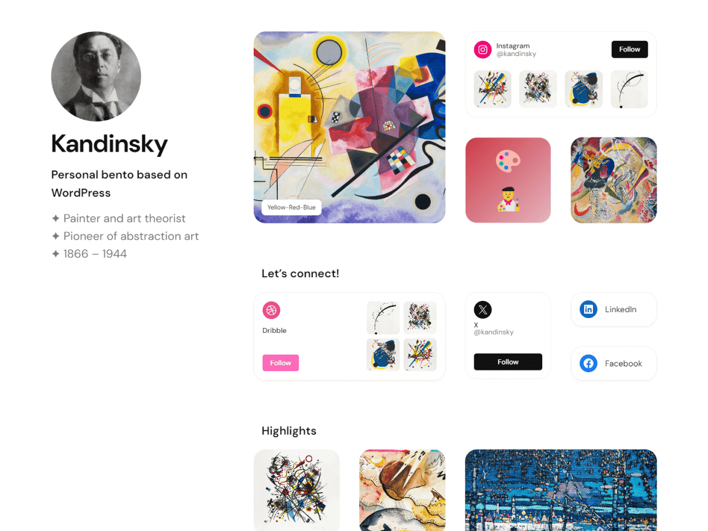

# Kandinsky Bento

  

Kandinsky Bento is the Block Theme designed to help you create a personal website that looks like 'bento.me' using WordPress. Create your personal single page website by clicks!

- **WordPress.org:** https://wordpress.org/themes/kandinsky-bento/
- **Live preview:** https://wp-themes.com/kandinsky-bento/

## Installation

1. Make sure you're running WordPress 6.5 or later.
2. Upload the theme.
3. Activate the theme.

To install the development version from this repository, download it as a ZIP (Code > Download ZIP), rename the folder inside to `kandinsky-bento` and upload it in Appearance > Themes > Add New Theme > Upload Theme.

## Requirements

- WordPress 6.5 or later
- Tested up to WordPress 7.1
- PHP 7.0 or later

## Changelog and credits

The full changelog, image and font credits with their licenses are listed in [readme.txt](readme.txt).

## License

Kandinsky Bento is distributed under the terms of the [GNU General Public License v2 or later](https://www.gnu.org/licenses/gpl-2.0.html).

---

More themes by Roman Fink: https://wordpress.org/themes/author/romanfink/
